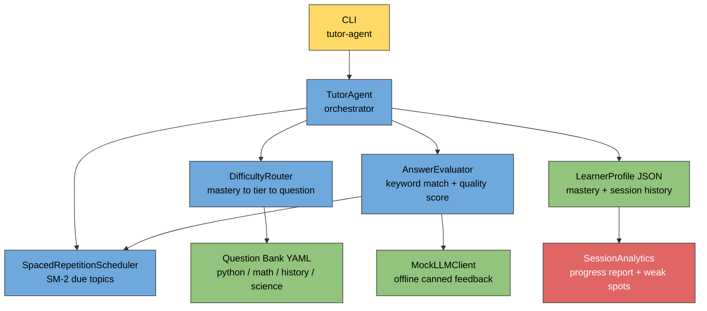

# Adaptive Tutor Agent with Mastery Memory

An offline-first adaptive tutoring system that personalises over time using SM-2 spaced repetition, mastery-driven difficulty routing, and persistent JSON learner profiles. Every component — including the LLM — runs entirely locally with no API keys or internet connection required.

---

## Features

- **SM-2 Spaced Repetition** — Topics are scheduled based on the classic SM-2 algorithm. Correctly answered questions earn longer review intervals; incorrect answers reset the interval and immediately re-queue the topic.
- **Three-Tier Difficulty Routing** — Mastery scores (0.0–1.0) automatically route each topic to Beginner (< 0.4), Intermediate (0.4–0.75), or Advanced (≥ 0.75) questions drawn from a YAML question bank.
- **Persistent Learner Memory** — Every `LearnerProfile` is atomically written to a local JSON file, capturing topic mastery, SM-2 state, and full session history across runs.
- **Offline MockLLMClient** — An OpenAI-compatible chat interface backed by keyword-matched canned responses. No API key, no network calls.
- **Keyword-Based Answer Evaluation** — Learner responses are scored by matching against per-question keyword lists; the ratio maps to SM-2 quality scores (0–5) which update mastery in-place.
- **Session Analytics & Weak-Spot Detection** — `SessionAnalytics` builds per-topic progress curves, flags weak spots (mastery < 40 % or accuracy < 50 %), and renders a colour-coded ASCII report.
- **Human-in-the-Loop Safeguards** — Profile reset and deletion require typing `RESET` or `DELETE` verbatim; any other input cancels the operation.
- **Configurable CLI** — A `tutor-agent` console command exposes `session`, `report`, `add-topics`, and `reset` sub-commands, all configurable via environment variables.
- **Full Test Suite** — 180+ pytest tests with coverage reporting covering every module, including multi-day integration simulations.

---

## Architecture



---

## Installation

**Requirements:** Python 3.9 or later.

```bash
# Clone the repository
git clone https://github.com/your-org/adaptive-tutor-agent.git
cd adaptive-tutor-agent

# Create and activate a virtual environment
python -m venv .venv
source .venv/bin/activate        # Windows: .venv\Scripts\activate

# Install the package in editable mode with development extras
pip install -e ".[dev]"
```

This installs the `tutor-agent` console command and all dependencies (`pyyaml`, `openai`, `pytest`, `pytest-cov`). No API keys are needed — the project runs entirely offline.

---

## Usage

### Add topics and run a session

```bash
# Register topics for a learner (creates the profile automatically)
tutor-agent --learner-id alice add-topics python math history science

# Run an interactive tutoring session (up to 10 questions by default)
tutor-agent --learner-id alice session

# Limit the session to 3 questions and register a topic at the same time
tutor-agent --learner-id alice session --max-questions 3 --topics science
```

### View a progress report

```bash
tutor-agent --learner-id alice report
```

Sample output:

```
==============================================================
  LEARNING PROGRESS REPORT
  Learner : alice
==============================================================

Overall Statistics
--------------------------------------------------------------
  Sessions completed : 4
  Questions answered : 12
  Correct answers    : 9
  Overall accuracy   : 75%

Per-Topic Progress
--------------------------------------------------------------
  python               [########..]  80%
  math                 [#####.....]  50%
  history              [###.......]  30% ⚠

Weak Spots Detected
--------------------------------------------------------------
  ⚠  history
     Mastery : 30%
     Reason  : Mastery 30% is below the 40% threshold.

Strongest Topics
--------------------------------------------------------------
  ★  python               80%
==============================================================
```

### Reset or delete a profile

```bash
# Reset mastery scores and session history (prompts for 'RESET' confirmation)
tutor-agent --learner-id alice reset

# Permanently delete the profile file (prompts for 'DELETE' confirmation)
tutor-agent --learner-id alice reset --delete
```

### Environment variable configuration

```bash
# Override all defaults via environment variables
export TUTOR_DATA_DIR=/var/lib/tutor/profiles
export TUTOR_LEARNER_ID=alice
export TUTOR_MAX_QUESTIONS=5
export TUTOR_MODEL_ENDPOINT=gpt-mock-4

tutor-agent session
```

---

## CLI Reference

```
tutor-agent [global options] <command> [command options]

Global options
  --data-dir DIR          Profile storage directory
                          (env: TUTOR_DATA_DIR, default: data/profiles)
  --model-endpoint MODEL  LLM model name string
                          (env: TUTOR_MODEL_ENDPOINT, default: gpt-mock-4)
  --learner-id ID         Learner identifier used to load/create a profile
                          (env: TUTOR_LEARNER_ID, default: default_learner)
  --display-name NAME     Human-readable learner name (new profiles only)

Commands
  session                 Run an interactive tutoring session
    --max-questions N     Maximum questions per session
                          (env: TUTOR_MAX_QUESTIONS, default: 10)
    --topics TOPIC ...    Register topics before the session starts

  report                  Print a progress report for a learner

  add-topics TOPIC ...    Register one or more topics in a learner profile

  reset                   Reset or delete a learner profile
    --delete              Permanently delete the profile file
```

---

## Running Tests

```bash
# Full suite with coverage (HTML report written to htmlcov/)
pytest

# Suppress coverage for a faster run
pytest --no-cov

# Run a specific test module with verbose output
pytest tests/test_spaced_repetition.py -v

# Run all tests and show uncovered lines inline
pytest --cov=tutor_agent --cov-report=term-missing
```

The test suite includes unit tests for every module and multi-day integration simulations in `tests/test_session_analytics.py` that run several sequential sessions and verify the analytics output reflects the full history correctly.

---

## Project Structure

```
adaptive-tutor-agent/
├── tutor_agent/
│   ├── __init__.py              # Package metadata, version 0.1.0
│   ├── cli.py                   # CLI entry point (tutor-agent command)
│   ├── tutor_agent.py           # TutorAgent orchestrator + SessionSummary
│   ├── learner_profile.py       # LearnerProfile, TopicMastery, SessionRecord
│   ├── spaced_repetition.py     # SpacedRepetitionScheduler (SM-2 algorithm)
│   ├── difficulty_router.py     # DifficultyRouter, DifficultyTier, Question
│   ├── answer_evaluator.py      # AnswerEvaluator, EvaluationResult
│   ├── mock_llm_client.py       # MockLLMClient (offline OpenAI-compatible)
│   └── session_analytics.py    # SessionAnalytics, AnalyticsReport, TopicProgress
├── data/
│   └── question_bank.yaml       # Question templates: python / math / history / science
├── tests/
│   ├── __init__.py
│   ├── test_cli.py
│   ├── test_tutor_agent.py
│   ├── test_spaced_repetition.py
│   ├── test_difficulty_router.py
│   ├── test_answer_evaluator.py
│   ├── test_mock_llm_client.py
│   ├── test_learner_profile.py
│   └── test_session_analytics.py
├── pyproject.toml               # Build config + console_scripts entry point
├── setup.cfg                    # Package metadata + pytest config
├── requirements.txt             # Pinned dependency list
└── README.md
```

---

## How It Works

### 1 — Learner Profile (`learner_profile.py`)

Each learner has a `LearnerProfile` dataclass persisted as a JSON file under `data/profiles/<learner_id>.json`. The file is written atomically via a `.tmp` rename to prevent corruption. The profile contains:

- **`topic_mastery`** — a dict of `TopicMastery` records, one per topic. Each record stores `mastery_score` (0.0–1.0), the SM-2 fields (`easiness_factor`, `interval_days`, `repetitions`), `next_review_date`, and `last_reviewed_date`.
- **`session_history`** — an ordered list of `SessionRecord` objects capturing when each session ran, which topics were practised, and how many questions were asked and answered correctly.

### 2 — Spaced Repetition (`spaced_repetition.py`)

`SpacedRepetitionScheduler` reads a `LearnerProfile` and implements an SM-2-inspired algorithm:

- **`due_topics()`** — returns topics whose `next_review_date ≤ today`, sorted most-overdue first, then by lowest mastery score.
- **`apply_review(topic, quality)`** — applies the SM-2 update rules for a quality score in [0, 5]:
  - Quality < 3 (incorrect): resets `repetitions` to 0 and `interval_days` to 1.
  - Quality ≥ 3 (correct): advances the interval (1 → 6 → `round(prev_interval × EF)`) and increments `repetitions`.
  - The easiness factor `EF` is updated via `EF + 0.1 − (5 − q) × (0.08 + (5 − q) × 0.02)`, clamped to a minimum of 1.3.
  - Mastery delta maps quality linearly: 0 → −0.20, 3 → 0.00, 5 → +0.20.

### 3 — Difficulty Routing (`difficulty_router.py`)

`DifficultyRouter` loads `data/question_bank.yaml` lazily and maps a mastery score to a `DifficultyTier`:

| Mastery score | Tier |
|---|---|
| < 0.40 | BEGINNER |
| 0.40 – 0.74 | INTERMEDIATE |
| ≥ 0.75 | ADVANCED |

If the preferred tier has no unused questions for a topic, the router falls back to adjacent tiers. Topic keys are matched case-insensitively with substring fallback. Unknown topics receive a generic `"Explain what you know about {topic}"` fallback question.

The question bank (`data/question_bank.yaml`) ships with three questions per tier for four subject areas: **python**, **math**, **history**, and **science**.

### 4 — Mock LLM Client (`mock_llm_client.py`)

`MockLLMClient` exposes an OpenAI-compatible interface (`client.chat.completions.create(model=..., messages=...)`) backed by a keyword-matching canned response bank. It returns `ChatCompletion` objects with the same structure as the real OpenAI SDK. No network calls are made. A `seed` parameter enables deterministic response selection for tests.

### 5 — Answer Evaluation (`answer_evaluator.py`)

`AnswerEvaluator.evaluate(question, learner_response)`:

1. Calls `MockLLMClient` to generate contextual feedback.
2. Counts how many of the question's `answer_keywords` appear in the learner's response (case-insensitive).
3. Maps the keyword coverage ratio to an SM-2 quality score (0–5).
4. Calls `SpacedRepetitionScheduler.apply_review()` to update the profile in-place.
5. Returns an `EvaluationResult` with before/after mastery, matched keywords, quality score, and correctness flag.

### 6 — TutorAgent Orchestrator (`tutor_agent.py`)

`TutorAgent.run_session()` ties all components together:

1. Fetches due topics from the scheduler.
2. Loops over topics (up to `max_questions_per_session`), routing each to a `Question` via the `DifficultyRouter`.
3. Presents the question via `input()` (injectable for tests), optionally showing a hint.
4. Passes the response to `AnswerEvaluator` and displays feedback.
5. Saves the profile after every answer.
6. Returns a `SessionSummary` with accuracy and per-question `EvaluationResult` objects.

Destructive operations (`reset_profile`, `delete_profile`) require the learner to type the exact strings `RESET` or `DELETE`; any other input cancels the operation and returns `False`.

### 7 — Session Analytics (`session_analytics.py`)

`SessionAnalytics.build_report()` reads the profile and computes:

- Aggregate session totals (questions asked, correct answers, overall accuracy).
- Per-topic `TopicProgress` with a linearly interpolated mastery history curve and weak-spot detection.
- **Weak spots**: mastery < 40 %, or accuracy < 50 % with ≥ 2 questions attempted.
- **Strongest topics**: non-weak topics ranked by current mastery.

`SessionAnalytics.print_report()` renders the full report as an ASCII table with mastery bars (`[######....]`) and sparkline trends to the console.

---

## Notes and Roadmap

### Current limitations

- The `MockLLMClient` uses keyword matching, not a real language model. Feedback quality is fixed to canned sentences. The interface is OpenAI-compatible, so swapping in a real client requires only changing the `--model-endpoint` and providing an API key.
- Mastery history curves are linearly interpolated from the current mastery score backward to 0.0, because per-answer mastery snapshots are not stored in the profile. Storing a mastery time-series would enable accurate non-linear curves.
- The question bank (`data/question_bank.yaml`) ships with four topics (python, math, history, science), three difficulty tiers, and three questions per tier. All content is static.
- Per-topic correct/incorrect counts inside a session are approximated by distributing session totals equally across practiced topics.

### Possible extensions

- **Real LLM integration** — Replace `MockLLMClient` with the real `openai.OpenAI` client; the `AnswerEvaluator` and `TutorAgent` require no changes.
- **Semantic answer scoring** — Replace keyword matching with embedding cosine similarity for more robust open-ended answer grading.
- **Expanded question bank** — Add more topics, more questions per tier, and support for image-based or multiple-choice questions in the YAML schema.
- **Exact mastery snapshots** — Store `(timestamp, mastery_score)` tuples after each evaluation to produce accurate progress curves in `SessionAnalytics`.
- **Web or TUI interface** — The `input_fn`/`print_fn` injection points in `TutorAgent` make it straightforward to swap the console I/O for a web framework or a rich TUI library.
- **Exportable reports** — Add CSV or Markdown export to `SessionAnalytics.print_report()`.